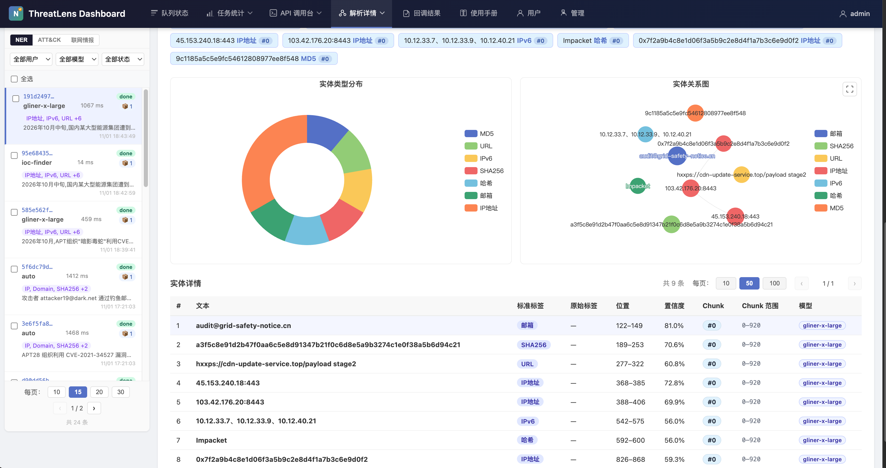
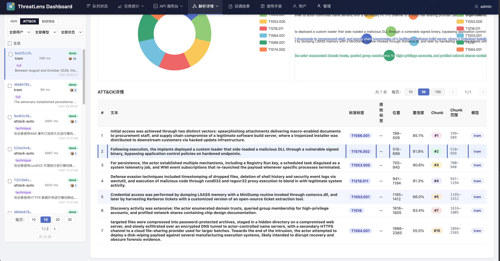
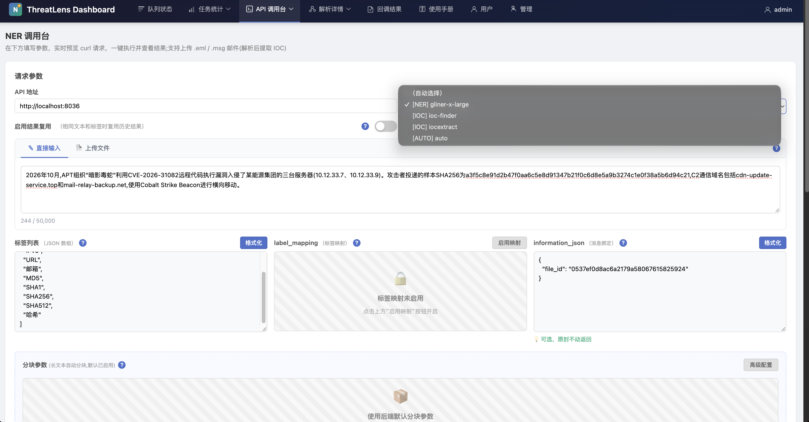
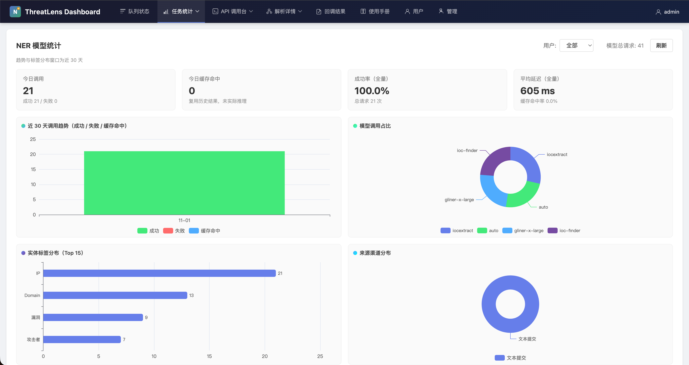
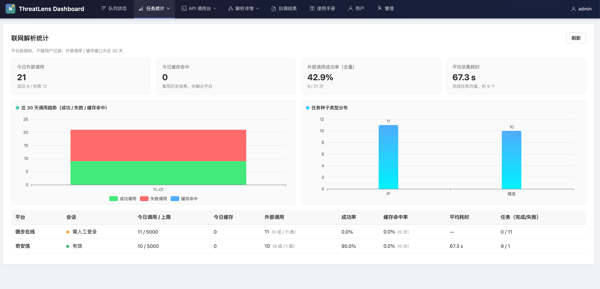
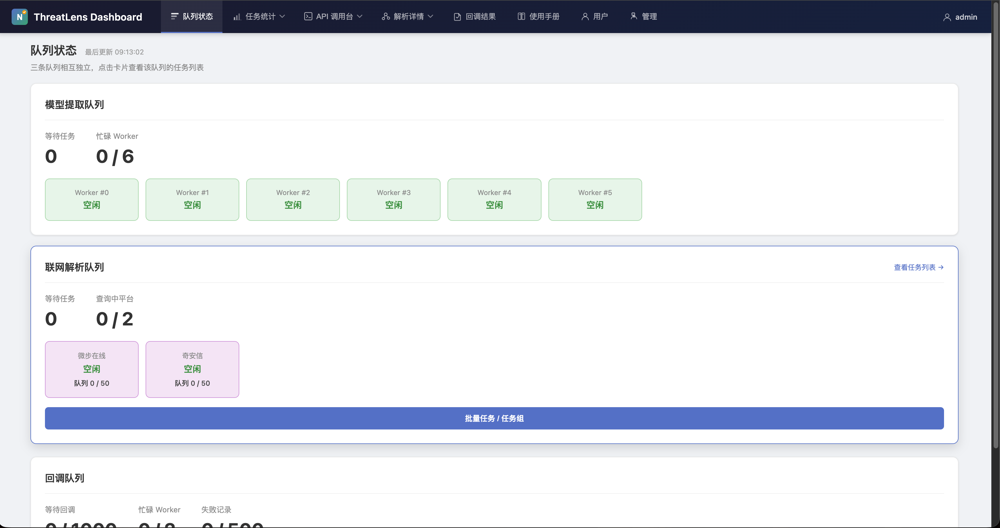

# ThreatLens-API

> 威胁情报实体提取平台 —— NER / ATT&CK / 联网情报,一站式提取与调度

<div align="center">

**NER 实体提取** · **ATT&CK 技术识别** · **联网情报扩线(微步/奇安信)**

</div>

---

## ✨ 功能

| 模块 | 说明 |
|---|---|
| **NER 提取** | gliner-x-large / ioc-finder / iocextract / auto 智能分流,支持自定义标签、分块、缓存复用 |
| **ATT&CK 识别** | tram(SciBERT)/ attack-auto(中英语言路由)/ qwen3 检索,输出技术编号与战术映射 |
| **联网情报** | 微步在线、奇安信 TI 平台自动扩线,Playwright 会话管理与登录态持久化 |
| **任务调度** | 异步队列、Worker 状态监控、结果缓存 TTL、Webhook 回调(成功/失败/重试) |
| **管理后台** | 用户与限额、模型统计、缓存管理、API 手册 |

## 🏗️ 架构

FastAPI + Vue3 + PostgreSQL,模型与会话运行时挂载、代码与镜像解耦,单 compose 一键起。

```
web/   Vue3 前端(仪表盘/调用台/统计)
api/   FastAPI 后端(队列/模型/回调)
docs/  手册与截图    tests/  测试
```

## 🚀 快速开始

```bash
# 1. 配置(数据库、模型、平台密钥)
cp api/.env api/.env.bak && vim api/.env

# 2. 启动(首次构建镜像约需数分钟)
docker compose up -d

# 3. 访问
open http://localhost:8036
```

> 详细部署与接口说明见 `docs/` 下各手册。改代码只需 `docker compose restart api`,无需重打镜像。

## 🖼️ 界面

| | |
|---|---|
|  |  |
|  |  |
|  |  |

---

<div align="center">

## 📬 联系我 / Contact

**微信扫码交流 / Scan to chat on WeChat**


</div>
